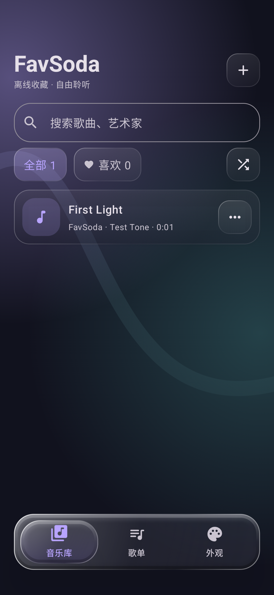
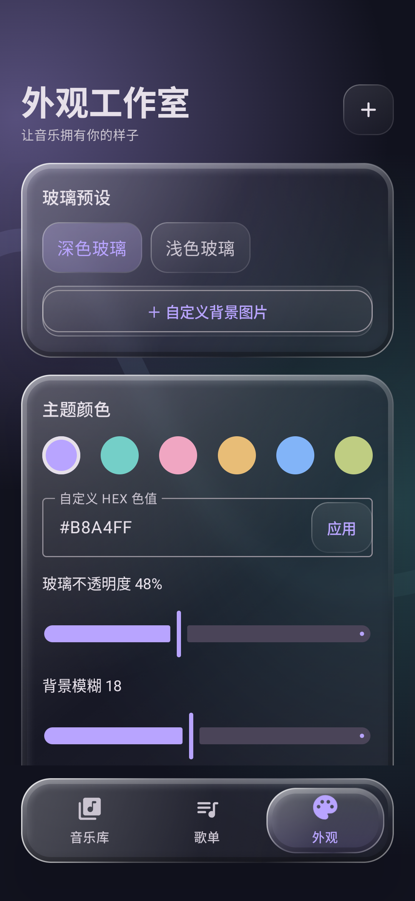
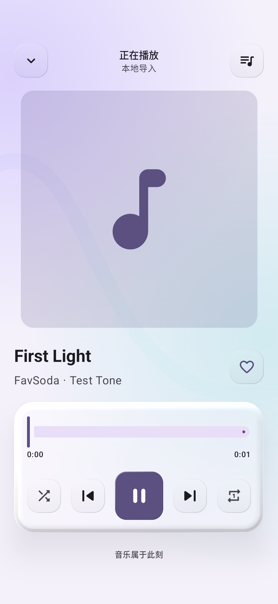
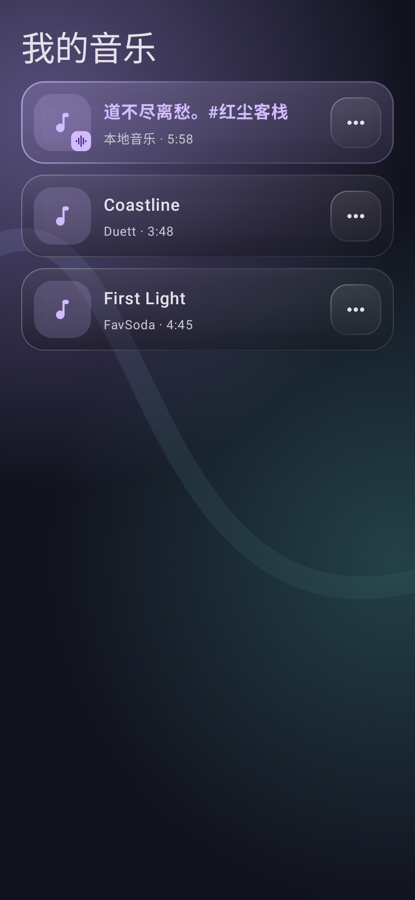
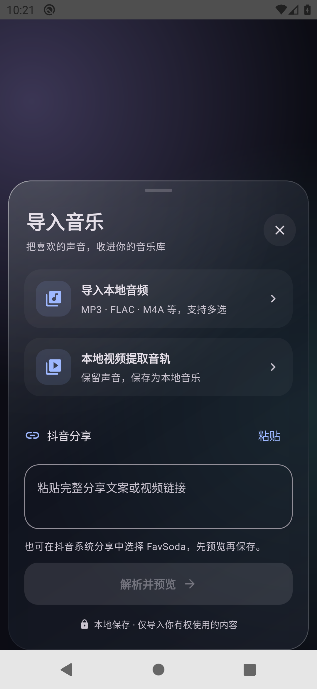
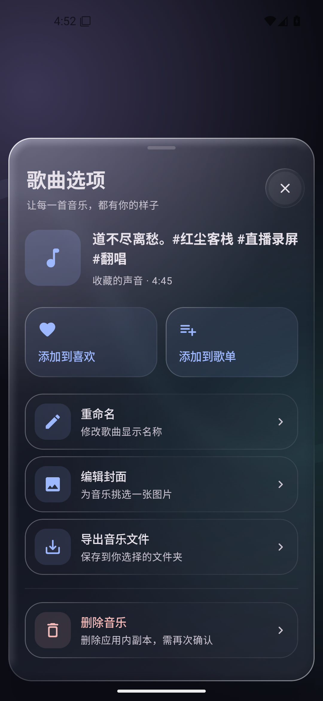

# FavSoda

[](https://github.com/winner798/GlassBeat/actions/workflows/android.yml)

开源、离线优先、可自定义的 Android 玻璃风格音乐播放器。

1.0.6：统一卡片列表分层、当前播放标记及圆角玻璃按钮，保留弹性滑动导航、立体玻璃和 Android 13+ 背景边缘折射。[实现与参考源码](docs/GLASS.md)。

**Kotlin · Jetpack Compose · Media3 · Room · DataStore · Haze**

<p>
  
  
  
  
</p>
<details>
<summary>二级界面布局（1.0.4）</summary>
<p>
  
  
</p>
</details>

## 功能

- **本地导入**：系统文件选择器批量导入 MP3、M4A、FLAC、WAV、OGG 等音频，复制到应用内保存，重启不丢失。可识别格式受系统解码器限制。
- **视频音轨**：通过 Media3 Transformer 去除视频轨道，保留/转码为 AAC，输出 M4A；显示进度并可取消。
- **分享导入**：接收 Android 系统分享的文本、音频或视频；抖音短链/长链通过独立适配器尝试解析公开资源，显示标题、时长与保存确认。失败时可直接进入本地视频提取。
- **稳定播放**：Media3 后台服务、锁屏控制、系统媒体通知、蓝牙媒体按钮、音频焦点、耳机断开暂停、随机播放、单曲循环、进度调整和播放队列。
- **音乐管理**：搜索标题/艺术家、收藏、歌单、重命名、删除应用内副本、更换封面及导出原音频文件。
- **玻璃外观**：深色、浅色、自定义图片背景，浮动播放条、玻璃导航、动态背景、Haze 实时模糊及渐变高光。
- **自由定制**：主题色/HEX、字体 TTF/OTF、玻璃不透明度、模糊强度、动画开关、低性能模式。设置持久化。
- **应用内更新**：在“外观 → 关于”点击“检查更新”，直接从 GitHub Releases 下载正式 APK；核对包名、递增版本、签名与可用的 SHA-256，再由系统确认覆盖安装。
- **无账号、无广告、无自建服务器**：本地音乐和主题离线可用，仅用户发起的链接解析、下载和应用更新需要网络。

## 安装与升级

APK 已在 [Releases](https://github.com/winner798/GlassBeat/releases) 提供；开发构建可在 [Actions](https://github.com/winner798/GlassBeat/actions) 的产物中下载。

原名 GlassBeat。为兼容已安装版本，包名和 GitHub 仓库地址保持不变；新版本显示名称为 FavSoda。

最低 Android 8.0（API 26）。Android 12 及以上支持实时背景模糊，旧设备自动回退为半透明材质。

**覆盖升级要求 APK 签名相同。** 不要为了安装不同签名的开发 APK 直接卸载旧版；先导出重要音乐。0.1.0 的 JSON 音乐库和深浅色设置会自动迁移到 Room / DataStore，旧索引保留为备份。

## 使用

1. 右上角 `＋` → 选择本地音频或视频。导入后点歌曲播放。
2. 从抖音的系统分享入口选择 FavSoda，或在导入窗口粘贴完整分享内容。
3. 解析成功后确认有权保存，点击“保存到音乐库”；解析失败时选择“本地视频提取”。
4. 歌曲右侧 `···` 可收藏、添加歌单、改名、编辑封面、导出或删除。
5. 在“外观”中调整主题；低性能模式关闭背景动画和实时模糊。

## 构建

Android Studio / JDK 17 / SDK 35：

```sh
./gradlew assembleDebug testDebugUnitTest lintDebug
```

APK：`app/build/outputs/apk/debug/app-debug.apk`。

设备验证：

```sh
./gradlew connectedDebugAndroidTest
```

CI 包含 Android 10 / Android 15 模拟器验证，覆盖 Room 关系与旧版迁移、真实视频音轨提取、界面导航、主题、分享失败反馈与截图。链接解析有独立 JVM 测试。测试用视频为纯色画面和自生成正弦波，不含第三方音乐。

## 明确的边界

- 抖音解析取决于公开媒体的可访问性。遇到登录、验证码、内容下架或站点结构变化会失败；应用不绕过这些限制，不承诺所有链接成功。当前不含账号 Cookie 导入或第三方解析服务。
- 提取的是视频完整音轨，不是平台标注原曲的完整版权曲目。仅保存你有权使用的内容。
- 任务在进程存活时继续，强制停止应用会中断未完成导入；不支持下载断点续传。
- 玻璃效果由背景模糊与高光组成，不声称物理准确的折射。
- 卸载会删除本地数据。请使用导出保留重要音乐。

## 项目文档

- [架构与升级策略](docs/ARCHITECTURE.md)
- [分享解析仓库调研与实测](docs/LINK_PARSERS.md)
- [验收与测试说明](docs/TESTING.md)
- [隐私说明](PRIVACY.md)
- [依赖与许可](docs/DEPENDENCIES.md)
- [贡献指南](CONTRIBUTING.md)
- [签名与正式构建](docs/SIGNING.md)
- [更新记录](CHANGELOG.md)

Apache-2.0。独立新建工程，未复制其他播放器源码。
